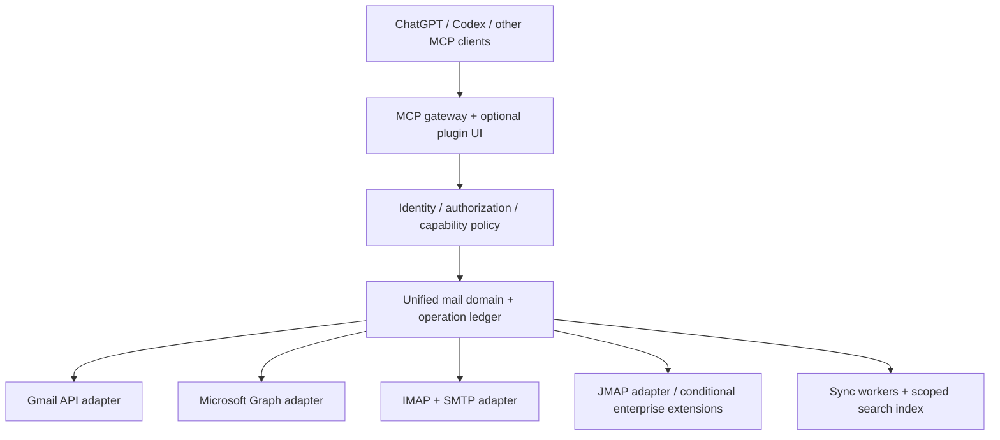

# anymail-connect

A unified, self-hostable email integration layer for MCP clients, with a planned ChatGPT plugin experience.

面向个人与企业邮箱的统一接入底座：原生 API 保留服务商能力，IMAP/SMTP 扩大兼容范围，通过 MCP 提供可审计的邮件工作流。

**状态：0.2.0 开发实现，可本地构建与验证。** 已有 Gmail API、Graph、IMAP/SMTP、JMAP 适配器，HTTP MCP、OIDC、管理界面、持久草稿/发送队列与同步。新增有界 IMAP IDLE、鉴权推送/自动续期、持久通知队列、Graph 云环境选择与 JMAP 跨源白名单。真实邮箱、生产部署和 ChatGPT 安装验收尚未完成。更新日期：2026-11-04（Asia/Shanghai）。

验证：102 项测试在 PGlite 与独立 PostgreSQL 17 各通过，另有实际 TLS/STARTTLS IMAP/SMTP、HTTP MCP SDK 与桌面/移动浏览器检查；详见 [0.2.0 变更与验证](docs/release-0.2.zh-CN.md) 和 [审查修复记录](docs/review-0.2.zh-CN.md)；[0.1.0 审查记录](docs/review.zh-CN.md) 保留为历史证据。

当前实现、边界与证据见 [实现状态](docs/implementation.zh-CN.md)、[TODO](TODO.md)、[部署与回滚](docs/deployment.zh-CN.md)。原下方内容为立项设计，实际行为以实现状态为准。

```sh
npm ci
npm run check
npm run build
```

Node.js 24+；默认测试使用合成邮箱与本机 TLS 协议服务器。部署需配置自己的 PostgreSQL、OIDC 和邮箱授权，见部署文档。

## 项目定位

目标是在服务商授权与协议允许的范围内，让 ChatGPT、Codex 及其他 MCP 客户端搜索邮件、阅读会话和附件、管理草稿、发送与整理邮件，并逐项对齐 Gmail / Outlook 插件的可观察工作流。

不承诺“所有邮箱、全部功能、完全一样”：封闭服务、企业策略、协议差异、客户端权限与展示能力都会形成边界。支持状态必须细化到“服务商 × 账号类型 × 操作 × 客户端”，不能只列一个品牌名。

## 建议技术路线



- 自研薄适配层，复用成熟协议库，不从零实现 IMAP/SMTP。
- Gmail 与 Microsoft 365/Outlook 优先使用原生 API；普通邮箱使用 IMAP/SMTP。
- 先提供自托管部署；多租户托管服务在隔离与真实邮箱验收通过后再开放。
- 先完成核心读写闭环，再扩展联系人、定时发送、共享邮箱、UI 与目录发布。
- EmailEngine / Nylas 已提供相关 API 与 MCP，可作为采购或验证路径，见调研；不将其商业代码作为本项目可自由分发的依赖。

## 文档

| 文档 | 内容 |
| --- | --- |
| [调研报告](docs/research.zh-CN.md) | 前提校正、竞品、技术边界、路线选择 |
| [功能与服务商矩阵](docs/capability-matrix.zh-CN.md) | 官方插件基线、原生能力、模拟能力与缺口 |
| [架构设计](docs/architecture.zh-CN.md) | 身份、协议、同步、发送状态与部署 |
| [实施路线与成本](docs/roadmap.zh-CN.md) | 阶段、验收门槛、工期估算与立项条件 |
| [验收计划](docs/acceptance.zh-CN.md) | 真邮箱、ChatGPT、故障恢复及安全边界 |
| [来源与证据](docs/sources.md) | 一手资料、读取限制与未验证事项 |

## 真实环境验收顺序

1. 冻结 Gmail / Outlook 可观察功能基线，在目标 ChatGPT 账号上验证自定义 MCP、OAuth、附件与 UI 的可达性。
2. 用受控测试邮箱验证 QQ、163、iCloud、Gmail、Outlook/Microsoft 365，以及一套企业 IMAP 服务。
3. 完成多账号隔离、搜索/读信/附件、草稿、发送、已读与移动；发送状态未知时不自动重发。
4. 扩展同步恢复、联系人、批处理、定时发送与企业共享邮箱。

## License

尚未选择项目许可证。公开 GitHub 仓库不等于已授予开源再分发许可。项目拥有者仍需选择项目许可证；第三方组件继续遵循各自许可证。

本项目与 OpenAI、Google、Microsoft 及各邮箱服务商无隶属关系。
