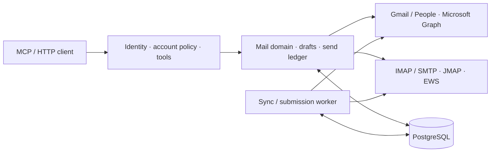

<p align="right"><strong>English</strong> · <a href="README.zh-CN.md">简体中文</a></p>


<h1 align="center">AnyMail Connect</h1>
<p align="center">Self-hosted email infrastructure for MCP clients.</p>
<p align="center">
  <a href="https://github.com/pythc/anymail-connect/actions/workflows/ci.yml"></a>
</p>
<p align="center"><a href="docs/quickstart.md">Quickstart</a> · <a href="docs/architecture.md">Architecture</a> · <a href="docs/deployment.md">Deploy</a> · <a href="docs/providers.md">Providers</a> · <a href="docs/api.md">API reference</a></p>

Connect personal and enterprise mailboxes through one authorization and workflow boundary. Native Gmail and Microsoft Graph adapters preserve provider capabilities; IMAP/SMTP, JMAP and administrator-approved EWS extend coverage.

**Development release.** A backend service, with no bundled mailbox dashboard or embedded MCP app. Small browser endpoints handle provider OAuth, authenticated source viewing and human approval of an exact email. Provider support is capability-based, not a promise of universal Gmail/Outlook feature parity.

## One boundary, multiple providers



| Adapter | Mailbox coverage | Authorization / boundary |
| --- | --- | --- |
| **Gmail + People** | Personal Gmail, Gmail-enabled Workspace | User OAuth; app and organization policies apply |
| **Microsoft Graph** | Outlook.com, Microsoft 365, delegated shared mailboxes | Delegated OAuth; tenant consent and mailbox grants apply |
| **IMAP + SMTP** | Providers and self-hosted servers exposing these protocols | TLS and provider-approved credentials; extension support varies |
| **JMAP** | JMAP-enabled services | Session URL and API token; explicit cross-origin policy |
| **EWS** | Administrator-approved on-premises Exchange | HTTPS endpoint with Basic/Bearer; no NTLM or autodiscovery |

Optional CardDAV adds a configured address book to a connection. [Provider notes](docs/providers.md) distinguish implemented behavior from deployment-specific acceptance.

## Designed around authority and state

- **A consistent integration surface.** Streamable HTTP MCP and an HTTP tool gateway share schemas, account policy, source citations and authenticated attachment resources.
- **Provider semantics stay visible.** Search coverage, folders versus labels, native drafts, contacts and shared-mailbox permissions retain their original constraints.
- **Explicit access.** OIDC identity, tenant/account isolation, independent read/write/send scopes, expiring same-tenant grants and revocation.
- **Durable mail workflows.** Revisioned drafts, exact-content approval, persisted idempotency and scheduled submission. Uncertain submissions stop for reconciliation.
- **An independent worker.** Checkpointed sync, periodic reconciliation, IMAP IDLE, authenticated Gmail/Graph notifications, native-draft conflict handling and retention.
- **Bounded attachment processing.** Authenticated bytes, limited extraction, opt-in offline OCR and explicitly selected private text indexes.

## Try it locally

Start with the [synthetic mailbox quickstart](docs/quickstart.md): prebuilt image, generated credentials, local OIDC and an explicit approval workflow. No real mailbox or cloud account is required. Submission is simulated. See [releases](https://github.com/pythc/anymail-connect/releases) for exact image digests and verification.

```sh
node scripts/demo.mjs init
docker compose --env-file .artifacts/demo/compose.env -f examples/demo/compose.yaml up -d --wait
node scripts/demo.mjs walk
```

## Deploy for real mail

You need **Node.js 24+**, **PostgreSQL** and an **OIDC provider**. Mailbox-provider OAuth is configured separately from the identity provider used to access AnyMail.

```sh
git clone https://github.com/pythc/anymail-connect.git
cd anymail-connect
cp .env.example .env
```

Configure secrets, identity and provider credentials using the [deployment guide](docs/deployment.md), then:

```sh
docker compose build
docker compose up -d
```

| Endpoint | Purpose |
| --- | --- |
| `/mcp` | Authenticated Streamable HTTP MCP |
| `/api/call/:tool` | HTTP gateway to the same tool registry |
| `/.well-known/oauth-protected-resource` | Resource and authorization-server discovery |
| `/connect` | Sign in and authorize a Gmail or Microsoft mailbox |
| `/healthz` | Process liveness, not provider readiness |

The root endpoint returns service metadata as JSON. Connect other supported providers through `POST /api/accounts/connect`; use your client for mail operations. [HTTP and MCP examples →](docs/api.md)

## Sending is a state transition

```text
draft → prepare exact revision → user reviews approval_url → durable queue → provider submission
                                                                            ↳ unknown: reconcile
```

Approval binds the actor, mailbox, recipients, body and attachment identity. A tool cannot approve its own send request. A provider acceptance response is not a delivery receipt, and an unknown submission is never automatically replayed.

## Develop and operate

```sh
npm ci
npm run check
npm run build
```

Regression tests and synthetic protocol fixtures belong in source control. Credentials, real-account acceptance data, personal task lists, build output and generated test reports do not. See [contributing](CONTRIBUTING.md) for the test layers and repository boundaries.

| Read next | Covers |
| --- | --- |
| [Architecture](docs/architecture.md) | Domain boundaries, authority, storage and worker behavior |
| [Deployment](docs/deployment.md) | OIDC, containers, network policy and MCP registration |
| [Provider configuration](docs/providers.md) | Gmail, Microsoft, protocol and enterprise constraints |
| [API reference](docs/api.md) | Tools, HTTP calls, files and approval |
| [Operations](docs/operations.md) | Backups, upgrades, rollback, key rotation and retention |
| [Security policy](SECURITY.md) | Review scope, untrusted content and disclosure |

## Join the project

Read the [adapter guide](docs/adapters.md), check [compatibility evidence](docs/compatibility.md), or pick a small [good first issue](https://github.com/pythc/anymail-connect/labels/good%20first%20issue). Questions belong in [Discussions](https://github.com/pythc/anymail-connect/discussions); public plans live in [Issues and milestones](https://github.com/pythc/anymail-connect/milestones). Please follow the [code of conduct](CODE_OF_CONDUCT.md) and use [private security reporting](https://github.com/pythc/anymail-connect/security/advisories/new) for vulnerabilities.

## License

[Apache-2.0](LICENSE). Dependencies retain their own licenses. This project is not affiliated with OpenAI, Google or Microsoft.

<sub>Cover artwork generated with OpenAI image generation.</sub>
