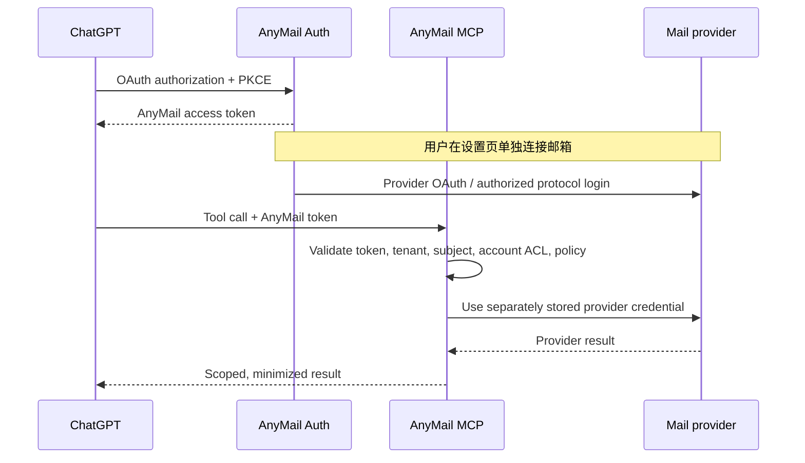

# 架构建议

> 历史调研/设计文档。当前代码与验证进展见 [实现状态](implementation.zh-CN.md) 和 [TODO](../TODO.md)；文中的“未开始”描述保留的是立项时状态。

本文为拟议设计，尚无实现。协议和宿主依据见[来源表](sources.md)，工程策略为本项目建议。

## 1. 组件和技术选择

建议 TypeScript + 届时仍受支持的 Node.js LTS，使用官方 MCP TypeScript SDK。IMAP 采用 ImapFlow、SMTP 采用 Nodemailer、MIME 采用 MailParser；原生 API 使用官方库或有类型的 HTTP 客户端。已读取的上游资料标注 ImapFlow/MailParser 为 MIT，Nodemailer 为 MIT-0；实现前锁定实际版本并核对包内 LICENSE，不能只按品牌推断许可。

起步采用一个 API 进程和一个持久 worker，避免在架构验证前拆成大量微服务。API 可用 Fastify 等框架，最终选择在 P0 锁版；数据库建议 PostgreSQL，任务队列优先复用数据库，达到连接/吞吐瓶颈再引入专用队列。长期 IMAP 连接由常驻容器 worker 承担，不放在短生命周期请求函数中。

拟议组件：

| 组件 | 职责 |
| --- | --- |
| MCP gateway | Streamable HTTP、schema、工具注解、限流、错误规范 |
| Authorization server / IdP | MCP OAuth 发现、PKCE、客户端注册策略、token 与撤权 |
| Connection settings | 邮箱 OAuth、授权码录入、连接健康与能力说明 |
| Mail domain | 统一结构、适配器接口、权限和操作台账 |
| Provider adapters | Gmail API、Graph、IMAP/SMTP；之后 JMAP |
| Sync workers | 初次/增量同步、恢复、限流、推送续期、定时任务 |
| Scoped data store | 元数据、映射、游标、操作、审计；按需对象存储 |
| Optional UI | 邮件列表、来源页、附件、草稿预览、发送授权 |

## 2. 两层授权、多账号和租户

采用现有、符合 MCP 要求的 OAuth/IdP 实现，不自行创造认证协议。资源元数据、authorization server metadata、issuer/audience、resource parameter、PKCE S256、redirect 精确匹配和撤权均需验收。按目标宿主的实际支持选择 CIMD、预注册客户端或 DCR，不能把某一种配置写死为所有部署通用。

MCP access token 只面向本服务；Gmail/Graph refresh token 和邮箱授权码由后端加密保存。密钥与密文分离；生产使用部署方的密钥管理设施。密文、日志和备份的删除周期要一并定义。

持久数据以不可变 `tenant_id + subject_id` 标识身份，`account_id` 为随机不透明 ID；不以可变邮箱地址作为授权主键。每次查询、附件下载、缓存命中、后台任务和写入都验证账号归属与有效权限。数据库行级隔离可作为纵深保护，不能替代服务层检查。

公开 profile 工具按 OpenAI 官方多账号格式识别当前连接身份；工具参数不得用于冒充另一用户。一个连接允许访问多个邮箱时，必须先通过认证后的列表选择 `account_id`。连接器服务商、连接身份、发件身份与共享邮箱委派身份分别建模。

## 3. 数据模型与原生差异

核心对象：Account、CapabilitySet、Message、MessageLocation、Thread、Folder、Label、Category、Attachment、Draft、SendIntent、Operation、SyncCheckpoint、AuditEvent。

- 内部消息 ID 稳定，服务商 ID、移动后的 ID 和版本单独映射。Graph 优先评估 ImmutableId；并非只要用了它就跨所有归档/迁移稳定。
- IMAP 定位必须包含账号、文件夹、UIDVALIDITY、UID；不使用 sequence number 作持久 ID。UIDVALIDITY 变更后停止使用旧映射，重建并拒绝旧写入目标。
- RFC Message-ID 可缺失、重复或被伪造，不能单独充当唯一数据库主键或去重证明。
- 标签、分类、文件夹保留独立集合；消息可存在多个位置。系统文件夹优先按服务商标识/IMAP SPECIAL-USE 识别，不硬编码中文或英文名字。
- 线程来源记录为 `provider` 或 `inferred`。主题相同不足以证明属于同一会话。
- 原生字段放在命名空间扩展内，统一字段表示共同语义；不做一个可以调用任意原始 API 的模型工具。

## 4. 工具与结果契约

建议按目标任务分组，实际公开名称在 P0 冻结：

- 身份：`profile`、`accounts.list`、`accounts.get_capabilities`。
- 读取：`messages.list/search/get/get_batch`、`threads.get`、`folders.list`、`attachments.list/get`。
- 草稿：`drafts.create/get/list/update`、`drafts.prepare_send`、`drafts.send`。
- 整理：`messages.set_read_state/move/trash`、`labels.list/create/apply`，之后增加分类与批量工具。
- 扩展：联系人、发送队列/取消、退订、共享邮箱；只在能力与授权允许时提供。
- 知识源入口：另提供符合宿主要求的标准 `search(query)` 和 `fetch(id)`；不拿邮件结构化搜索参数冒充标准检索 schema。

所有读结果有分页和大小限制。跨账号搜索返回每个账号的状态、时间范围和游标，不把部分失败显示为“没有邮件”。同样区分 message count 与 thread count、服务端总数与缓存覆盖内数量。

结果建议包含 `account_id`、稳定对象 ID、`source_url`、`observed_at`、`sync_status`、`coverage`、`truncated`、逐项错误。来源页是本服务鉴权后的 HTTPS 页面，不通过 URL 参数泄漏邮箱或 token；支持原生深链时可以附带原生链接。附件元数据先行，内容按需下载；大文件不塞入模型 JSON。

错误至少区分：`AUTH_REQUIRED`、`PERMISSION_DENIED`、`UNSUPPORTED_CAPABILITY`、`RATE_LIMITED`、`STALE_REFERENCE`、`SYNC_INCOMPLETE`、`PARTIAL_FAILURE`、`SEND_STATUS_UNKNOWN`。网络错误不自动变成空结果。

## 5. 草稿、发送和定时任务

发送是最需要谨慎处理的流程：

1. 保存草稿并得到 revision，明确保存位置为邮箱或本服务。
2. 准备 SendIntent，冻结发件身份、To/Cc/Bcc、主题、正文、附件内容 hash、回复目标和定时时间。
3. 对首次/敏感发送，在认证后的可信 UI 展示确切内容，由用户动作形成授权记录。不能用模型传入的 `confirmed=true`，也不能因模型连续调用“准备”“确认”两个工具就视为人已同意。
4. 授权绑定主体、租户、客户端、邮箱、草稿版本、内容摘要、到期时间与一次性 nonce。修改任一关键字段后重新授权。其他客户端无可验证确认能力时提供服务端确认链接，或只开放草稿。
5. 提交前重新鉴权，持久记录幂等键与状态后再调用服务商。worker 以租约和状态转换防止并发重复提交。
6. 返回 `submitted` / `provider_accepted` / `failed` / `unknown`；只有另有可信证据才标记 `delivered`。

SMTP 最后确认丢失、进程在服务商接受后崩溃、Graph 202 后状态查询失败，都可能产生 unknown。此时只做查询与对账，不自动重新创建或提交邮件。Message-ID、内容 hash、幂等键用于减少重复和辅助对账，不宣称能够跨所有服务商实现 exactly-once。

SMTP 成功后“写入发件箱”是独立操作。有的服务端会自动保存，有的需要 IMAP APPEND。按连接明确策略；保存副本失败不能重发原信。SMTP 对多个收件人可能部分接受，应分别报告，不盲目向全部收件人重试。

IMAP 草稿更新不是统一的原子操作；无可靠更新/版本控制能力时采用应用内草稿并明确标注。定时发送默认由本服务调度，应记录时区、取消状态和已批准内容；到期前重检账号撤权、凭证和权限，不能依赖聊天保持在线。

## 6. 同步、检索和性能

Gmail 用初次同步 + history 增量，watch/PubSub 可做触发器；Graph 按文件夹持有 delta，webhook 触发后再拉取实际变化；IMAP 用 UID、可用扩展、IDLE 与周期性对账组合。通知是触发器，不是完整变更账本，漏推/重复推都应可恢复。

每个同步游标在变更数据持久化后提交。游标失效、重命名、移动、删除、配额和 provider throttling 必须有恢复状态；不能遇到错误就全账号频繁重扫。尊重 Retry-After，按账号限流，带抖动退避。撤权立即停止新任务并取消未提交发送；已被服务商接受的邮件不能承诺撤回。

第一阶段优先服务商搜索和结构化过滤，最近邮件可选有限缓存。中文及跨服务商全文索引要单独实现和测试：PostgreSQL 默认全文配置不能直接保证中文分词质量。附件全文、语义检索和 embedding 是额外数据处理路径，默认关闭并明确成本与授权。

返回搜索模式、索引覆盖期、最后同步时间和不完整原因。未完成历史同步时只能声称“在已覆盖范围内未发现”，不能声称全邮箱没有。

## 7. 部署与安全边界

部署层次：单用户自托管 → 企业私有部署 → 多租户托管。复用业务核心，区分网络策略、密钥、租户策略与管理员配置。先提供容器化开发/部署，再考虑更复杂编排。

- 邮件正文/附件是非可信数据，不能授予工具权限。恶意邮件要求转发、上传凭证或外连时，不产生授权。
- HTML 必须清洗；禁脚本、主动内容和默认远程图片。MIME 解析器与附件解析器设时间/大小/嵌套深度限制，解析任务与凭证进程隔离。
- 托管模式的自定义 IMAP/SMTP 主机、Autodiscover、OAuth 元数据和重定向都可能形成 SSRF。限制协议/端口、校验证书、解析全部 IP、处理 DNS 重绑定及重定向；不允许任意 URL 变成外连工具。
- 企业确需内网服务器时，仅允许管理员预配置的精确目的地与受限 worker 网络；不能让普通用户开启“允许所有内网”。
- 上传附件使用绑定用户和租户的句柄；下载权限即时复核，公共短链不作为默认方案。文件交给 ChatGPT 的具体机制在 P0 验证，不能复刻官方内部 file_uri。
- 审计记录操作 ID、主体、账号、结果和时间；默认不记录完整正文、附件或凭证。维护只读与发信权限分离。
- 邮箱本身允许访问，不等于用户同意把整库发送给模型。设置页说明凭证、缓存、索引、模型可见内容与保留/删除策略。

## 8. 升级与回滚

工具 schema 和来源 ID 保持兼容，数据库采用 expand/contract 迁移；旧版本可读的字段在回滚窗口保留。迁移前备份并演练恢复，不以“备份文件存在”代替恢复验证。

升级前停止领取新发送任务，等待正在提交的操作进入明确状态；unknown 保留待对账。恢复旧版本时复用操作台账和幂等记录，不清空发送队列后重放。同步游标与后台任务版本不兼容时应拒绝启动或执行受控迁移，不能静默跳过邮件。发布门槛见[验收计划](acceptance.zh-CN.md)。
